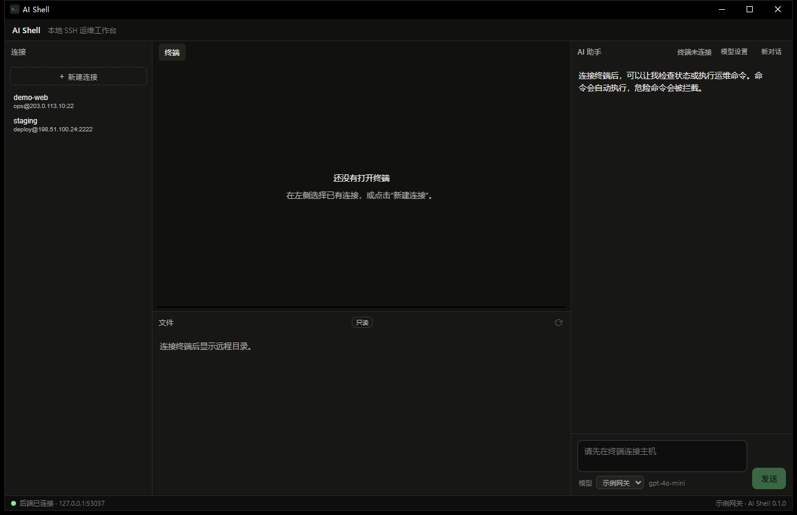
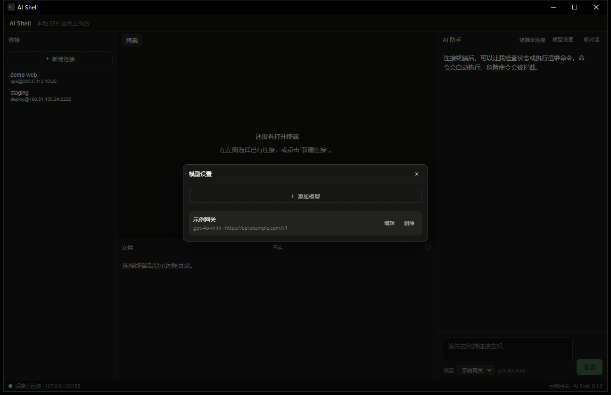
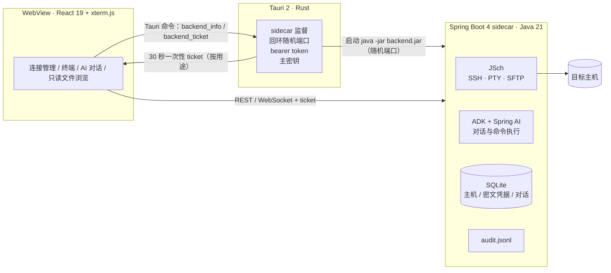

<div align="center">

# AI Shell


[](LICENSE)


**面向运维人员的桌面 SSH 工作台：终端、AI 助手和审计都落在同一个会话里。**

</div>

AI Shell 是一个 Windows 桌面应用。把常用的 SSH 连接存成配置，点一下就连上；终端里敲命令的同时，右侧 AI 助手看着同一个会话——它执行命令用的就是你眼前这个 PTY，`cd` 到哪里、导过什么环境变量，它都清楚。

它面向的是“让 AI 帮忙干活，但我得看得见、拦得住、查得到”的场景：

- **看得见** —— AI 的命令和输出直接写进终端，而不是藏在黑盒日志里。
- **拦得住** —— 危险命令 deny-list、单条命令超时、同一会话只允许一条命令在途、随时全局停止。
- **查得到** —— 用户和 AI 发出的每条命令都写进 `audit.jsonl`，按大小自动轮转。

除了连主机和调模型，应用不访问任何外部服务，也不采集遥测；主机、凭据、对话都留在本机 `%APPDATA%\com.aishell.desktop`。

## 界面

| 主界面 | 模型设置 |
| :---: | :---: |
|  |  |

## 功能

- **连接管理**：一行为一条 Connection Profile（名称 + `用户@地址:端口`），同一主机可以有多套凭据配置；私钥或密码加密保存，最新创建的排在前面，当前已打开的会话显示绿点；常用连接可收藏，并可标记为生产、测试或开发环境。
- **多会话工作区**：可以同时打开多个 SSH 会话，顶部标签页切换终端、文件浏览和对应的 AI 对话，关闭标签只结束该会话。
- **终端**：xterm.js + JSch PTY，窗口大小同步，密码与首次主机指纹确认直接渲染进终端，审计状态以徽标提示；网络中断后保留连接上下文并按退避策略自动重连，也可手动重新连接。
- **命令历史**：在当前终端查看审计过的用户与 AI 命令，按命令或工作目录搜索，可复制、确认后再次执行，或把命令和结果回填到 AI 进行自然语言分析。
- **AI 助手**：基于 Google ADK 的流式对话，AI 命令与用户共享同一个 PTY，状态连续；对话按主机持久化、跨重启保留，可回看命令输出、复制命令或输出，并从失败步骤发起重试；可随时“新对话”分段，也能删除某一轮。
- **模型设置**：模型连接信息（名称、Base URL、模型名、API Key）在应用内维护，可保存多个档案，每次提问时在下拉框里选；API Key 加密存库，不写配置文件。
- **安全护栏**：支持自动执行、逐条确认和仅解释三种 AI 命令策略；危险命令 deny-list、每条命令超时、同一会话只允许一条命令在途、全局停止、完整审计（`audit.jsonl`，按大小轮转）。
- **只读文件浏览**：底部面板左侧是从 `/` 开始的目录树（单击展开），右侧是六列表格（名称、大小、类型、修改时间、权限、用户/用户组），支持面包屑、上一级与文本/图片预览。没有上传、下载、删除和在线编辑。

## 架构



关键约定：

- **bearer token 只存在于 Rust 进程**。webview 拿不到访问凭据，只能换取 30 秒有效、单次使用、按用途（`terminal` / `hosts` / `files` / `chat` / `models`）绑定的 ticket。
- **凭据加密落盘**。连接配置的密码/私钥口令与模型 API Key 用 AES-256-GCM 加密；主密钥由 Rust 生成并存入 Windows 凭据管理器（`AI Shell/master-key`），经环境变量传给后端，主密钥不可用时写密钥直接返回 503。
- **确认发生在终端里**。密码输入与首次主机指纹确认由 JSch 的 `UserInfo` 渲染进终端，不弹系统对话框，也不进日志。
- **一次连接、一套凭据**。终端、AI 执行与文件浏览共用同一个 SSH Session。

## 技术栈

| 层 | 技术 |
| --- | --- |
| 桌面壳 | Tauri 2（Rust、WebView2），Windows Job Object 防孤儿进程 |
| 前端 | React 19、TypeScript、Vite 7、xterm.js 6 |
| 后端 | Java 21、Spring Boot 4.0.2（webmvc + websocket）、JSch 2.28.8 |
| AI | Google ADK 1.13.0 + `google-adk-spring-ai`、Spring AI 2.0.1，任意 OpenAI 兼容网关 |
| 存储 | SQLite（`sqlite-jdbc`）、`audit.jsonl` 审计文件 |
| 打包 | Maven + jlink 运行时 + NSIS 安装包 / 便携 zip |

## 快速开始

### 使用发行包

从 Releases 下载便携包解压后直接运行 `ai-shell.exe`，或使用 NSIS 安装包。便携包自带 jlink 运行时，不需要预装 Java。安装包未签名，SmartScreen 会给出提示。

### 从源码运行

环境要求：Windows 10/11 x64、JDK 21、Maven 3.9+、Node.js 20+、Rust stable 与 MSVC 构建工具、WebView2 Runtime（Windows 11 自带）。

```bash
# 1. 前端依赖
npm install

# 2. 后端 jar（Rust 启动 sidecar 时优先读 backend/target/backend-0.0.1-SNAPSHOT.jar）
cd backend && mvn package && cd ..

# 3. 启动桌面应用（Vite dev server + Tauri 窗口 + 后端子进程）
npm run tauri dev
```

只调样式时可以 `npm run dev`，但页面依赖 Tauri 的 `backend_info` / `backend_ticket` 命令，脱离 Tauri 窗口无法连上后端。

### 第一次使用

1. 左侧「新建连接」填名称、`用户@地址:端口`，选私钥或密码，保存。
2. 点击该连接，终端里按提示输入密码或确认主机指纹。
3. 右侧「模型设置」添加一个模型档案：名称、Base URL、模型名、API Key。
4. 在 AI 面板选择模型并提问。模型需要支持 OpenAI 兼容的 `/chat/completions` 与流式返回。

## 安全模型

| 边界 | 做法 |
| --- | --- |
| webview ↔ 后端 | bearer token 只在 Rust；webview 每次请求先换一次性 ticket |
| 凭据 | AES-256-GCM 加密；主密钥在 Windows 凭据管理器，绝不出现在配置文件里 |
| SSH 主机身份 | 首次连接在终端里确认指纹，之后写入数据目录下的 `known_hosts` |
| AI 执行 | 全自动执行，但受 deny-list、超时、单命令在途、全局停止约束 |
| 审计 | 用户与 AI 的命令都写 `audit.jsonl`，默认 10 MiB 轮转、保留 5 份 |
| 文件浏览 | 只读；不提供上传、下载、删除、在线编辑 |

AI 处于全自动执行模式，护栏是兜底而不是审批：请确认目标主机的信任边界，不要把生产核心节点交给不可信的模型网关。

## 测试

```bash
# 后端单元与集成测试（排除需要真实模型密钥的 live spike）
cd backend && mvn test "-Dtest=!DeepSeekSpikeTest"

# 前端类型检查 + 构建
npm run build

# Rust 侧
cd src-tauri && cargo test
```

需要真实主机的 live 用例默认跳过，设置以下环境变量后自动启用：

| 变量 | 说明 |
| --- | --- |
| `AISHELL_LIVE_HOST` / `AISHELL_LIVE_USER` / `AISHELL_LIVE_KEY` | 目标主机、用户、私钥路径 |
| `AISHELL_LIVE_PORT` | 可选，默认 22 |
| `AISHELL_LIVE_SHELL` | 可选，断言登录 shell（`bash` / `zsh`） |

`DeepSeekSpikeTest`（ADK + Spring AI 真实网关）同样只读环境变量，与应用内的模型设置互不影响：

| 变量 | 说明 |
| --- | --- |
| `DEEPSEEK_API_KEY` | 未设置时该测试自动跳过 |
| `DEEPSEEK_BASE_URL` | OpenAI 兼容网关地址 |
| `DEEPSEEK_MODEL` | 模型名 |

## 打包

```powershell
# 便携包 + NSIS 安装包（跳过测试；先关掉正在运行的便携版，否则 jvm.dll 被占用）
powershell -ExecutionPolicy Bypass -File scripts/package.ps1 -SkipTests -Bundle nsis
```

产物：

- `src-tauri/target/release/bundle/nsis/AI Shell_0.1.0_x64-setup.exe`
- `release/AI-Shell-0.1.0-win-x64.zip`（解压后 `ai-shell.exe` 自带 `backend/backend.jar` 与 jlink 运行时）

不加 `-Bundle` 只构建便携目录；不加 `-SkipTests` 会先跑 `mvn package` 的测试。

## 配置与数据

应用启动时由 Rust 注入，正常使用不需要手动设置：

| 变量 | 说明 |
| --- | --- |
| `AI_SHELL_TOKEN` | 后端 bearer token，Rust 生成随机会话密钥 |
| `AI_SHELL_MASTER_KEY` | 主密钥（base64），来自 Windows 凭据管理器 |
| `AI_SHELL_DATA_DIR` | 数据目录，默认 `%APPDATA%\com.aishell.desktop` |

开发调试用的可选变量：`AI_SHELL_BACKEND_JAR`（覆盖后端 jar 路径）、`AI_SHELL_JAVA`（覆盖 java 可执行文件）。

数据目录内容：

- `ai-shell.db` — 主机、连接配置（密文）、模型档案（API Key 密文）、对话与消息、ADK 会话
- `known_hosts` — SSH 主机指纹
- `audit.jsonl` / `audit.jsonl.1` … — 审计日志
- 后端日志：`%LOCALAPPDATA%\com.aishell.desktop\logs\backend.log`

## 项目结构

```
src/                 React 前端（连接、终端、AI、文件面板、状态栏）
src/api/             调用后端 REST 的客户端（ticket 由 Rust 命令换取）
src-tauri/           Tauri 壳：sidecar 监督、ticket、凭据管理器、打包配置
backend/             Spring Boot sidecar（SSH/PTY/SFTP、ADK、SQLite、审计），按功能分包
scripts/package.ps1  一条命令完成 jar → jlink → tauri build → 便携目录/zip
docs/adr/            架构决策记录（ADR 0001–0017）
GLOSSARY.md          领域术语表（Host / Profile / Session / Conversation …）
```

## 设计文档

每个有取舍的地方都留了 ADR，`docs/adr/` 按编号读即可串起整个设计：

| ADR | 主题 |
| --- | --- |
| 0001 | 本地 sidecar 架构 |
| 0002 | AI 全自动执行与护栏 |
| 0003 | 用户与 AI 共享终端、会话独占 |
| 0004 | Spring Boot 4 + ADK + Spring AI |
| 0005 | sidecar 握手与 token 归属 |
| 0006 | 终端 WebSocket 与 ticket |
| 0007 | 聊天 SSE 与 AI 命令执行 |
| 0008 | 连接配置与凭据存储 |
| 0009 | 复用终端 Session 的只读 SFTP 文件浏览 |
| 0010 | shell 钩子与用户命令审计 |
| 0011 | 对话持久化 |
| 0012 | 打包与分发 |
| 0013 | 原生窗口输入链路验证 |
| 0014 | 聊天轮次时间线与会话内删除 |
| 0015 | 用户自配置的模型档案与按轮选择 |
| 0016 | AI 命令执行策略与确认 |
| 0017 | AI 操作过程与结果回看 |
| 0018 | 连接与终端中断恢复 |
| 0019 | 多会话工作区与连接标记 |
| 0020 | 命令历史与自然语言复用 |

## 已知限制

- 只验证了 Windows x64；安装包未签名，暂无自动更新与 MSI。
- jlink 运行时约 48 MB，fat jar 约 288 MB（ADK 传递依赖较大）。
- 一个 `地址:端口` 同时只维护一段“当前对话”，同一主机的并发 AI 轮次未串行化。
- shell 钩子只覆盖当前会话的 bash/zsh；嵌套或切换 shell 不会重新注入，被历史抑制的命令只能标记不能捕获原文。
- 文件浏览只读，没有上传、下载、删除、在线编辑与右键菜单。
- 仍处于早期版本，数据库结构、接口与界面上都可能变动。

## 贡献

Issue 和 PR 都欢迎。涉及安全边界的改动（ticket、凭据、审计、执行护栏）请先开 issue 说明动机，并在 `docs/adr/` 补一条决策记录；提交前跑一遍上面的测试命令。

## License

[MIT](LICENSE) © 2026 shengpj
